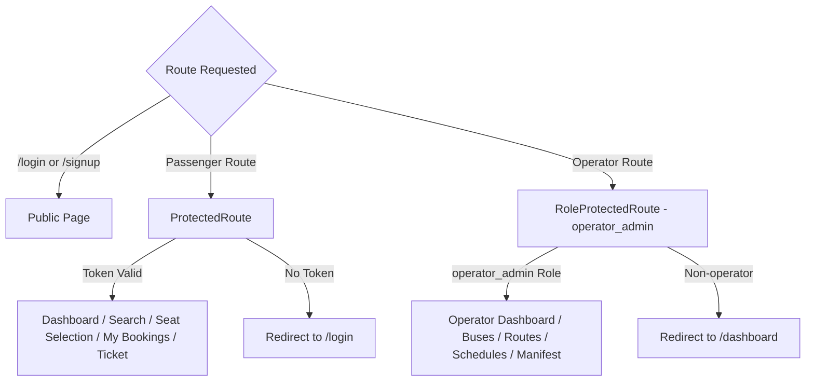

# TicketDot Frontend 🎫💻
> Responsive, modern Single Page Application (SPA) for bus ticket reservation and operator fleet management built with React 19, Vite, and Tailwind CSS v4.

---

## 📑 Table of Contents
1. [Overview](#-overview)
2. [Tech Stack](#-tech-stack)
3. [Key Features & User Experience](#-key-features--user-experience)
   - [Passenger Portal](#passenger-portal)
   - [Operator Portal](#operator-portal)
4. [Getting Started & Local Setup](#-getting-started--local-setup)
   - [Prerequisites](#prerequisites)
   - [Environment Variables](#environment-variables)
   - [Installation](#installation)
   - [Running Development Server](#running-development-server)
   - [Production Build](#production-build)
5. [Application Routing & Route Guards](#-application-routing--route-guards)
6. [API Integration Layer](#-api-integration-layer)
7. [Directory Structure](#-directory-structure)
8. [Test Accounts](#-test-accounts)

---

## 🌟 Overview

The TicketDot frontend is the client-side interface for passengers and bus operators. It connects to the TicketDot Go backend API, providing:
- Real-time city search and schedule discovery.
- Interactive seat selection supporting multi-seat bookings (up to 6 seats).
- A synchronized 5-minute seat locking countdown timer.
- E-ticket generation with instant printing and self-service cancellation.
- A dedicated Operator portal for fleet registration, route planning, trip scheduling, and live passenger manifest monitoring.

---

## 🛠 Tech Stack

- **Framework**: [React 19](https://react.dev/)
- **Build Tool & Bundler**: [Vite 8](https://vitejs.dev/) with React Compiler preset
- **Styling**: [Tailwind CSS v4](https://tailwindcss.com/)
- **Routing**: [React Router DOM v6](https://reactrouter.com/)
- **Icons**: [Lucide React](https://lucide.dev/)
- **HTTP Client**: [Axios](https://axios-http.com/) with request/response interceptors

---

## ✨ Key Features & User Experience

### Passenger Portal
1. **Origin & Destination Autocomplete**:
   - Native `<datalist>` backed by `GET /cities` dynamic discovery.
   - Prevents invalid city entries.
2. **Dynamic Search & Filtering**:
   - Filter trips by departure time window (Morning 6AM-12PM, Afternoon 12PM-6PM, Evening 6PM-11PM, Night 11PM-6AM).
   - Filter by bus type (`AC Sleeper`, `AC Seater`, `Non-AC`).
   - Dynamic operator checkboxes automatically aggregated from active search results.
   - Live sorting by Price (Low to High / High to Low) and Departure Time.
3. **Interactive Multi-Seat Selection**:
   - Visual seat map with instant color-coded status badges (`Available`, `Locked`, `Booked`, `Selected`).
   - Select up to 6 seats with live price computation (`Seats × Fare`).
4. **5-Minute Lock Countdown & Auto-Release**:
   - Synchronized timer based on backend `lock_expires` timestamp.
   - Automatic seat release and toast alert when timer hits zero.
   - Clean seat release via `POST /bookings/release` if the user leaves the page or clicks Back.
5. **Consolidated Confirmation & E-Ticket**:
   - Displays all confirmed seats under one 8-character booking reference (`booking_ref`).
   - Printable and downloadable e-ticket layout.
   - Self-service booking cancellation freeing seats instantly.

### Operator Portal
1. **Live Analytics Dashboard**:
   - Live KPI cards: Total Buses, Active Routes, Upcoming Schedules, Bookings, Gross Revenue.
2. **Bus Fleet Management**:
   - Register buses by registration number and vehicle type with automatic seat capacity setup.
3. **Route Planning**:
   - Connect cities with source and destination dropdowns powered by verified cities data.
4. **Schedule Creation**:
   - Select existing route and fleet bus, set departure and arrival timestamps and base fare.
5. **Passenger Manifest**:
   - Comprehensive manifest table displaying Passenger Name, Email, Phone, Route, Bus Number, aggregated seats (`A1, A2, A3`), total fare, and confirmed date.
   - Live search filter by booking reference or passenger name.

---

## 🚀 Getting Started & Local Setup

### Prerequisites
- **Node.js**: Version `18.x` or `20.x` or higher ([Download Node.js](https://nodejs.org/))
- **npm**: Version `9.x` or higher (comes with Node.js)
- **TicketDot Backend**: Ensure the Go backend API is running on `http://localhost:8080`.

---

### Environment Variables

Copy `.env.example` to `.env`:

```bash
cp .env.example .env
```

Verify the API URL matches your backend:

```env
VITE_API_BASE_URL=http://localhost:8080
```

---

### Installation

Install project dependencies:

```bash
npm install
```

---

### Running Development Server

Start Vite development server with Hot Module Replacement (HMR):

```bash
npm run dev
```

Open your browser at:
```
http://localhost:5173
```

---

### Production Build

To build the optimized production bundle:

```bash
npm run build
```

The output will be generated inside the `dist/` directory.

To locally preview the production build:

```bash
npm run preview
```

---

## 🛡 Application Routing & Route Guards

Client-side routes are defined in [`src/App.jsx`](file:///D:/PROJECTS/TicketDot/ticketdot-frontend/src/App.jsx):



| Path | Component | Guard | Description |
|---|---|---|---|
| `/login` | `Login.jsx` | Public | User authentication |
| `/signup` | `Signup.jsx` | Public | Account registration |
| `/dashboard` | `Dashboard.jsx` | `ProtectedRoute` | City search & trip initiation |
| `/search` | `SearchResults.jsx` | `ProtectedRoute` | Trip search results & filters |
| `/seat-selection` | `SeatSelection.jsx` | `ProtectedRoute` | Seat map & 5-minute lock timer |
| `/booking-success` | `BookingSuccess.jsx` | `ProtectedRoute` | Post-booking confirmation |
| `/my-bookings` | `MyBookings.jsx` | `ProtectedRoute` | Multi-seat order history |
| `/ticket/:bookingRef` | `TicketDetails.jsx` | `ProtectedRoute` | Printable e-ticket & cancellation |
| `/operator/dashboard` | `OperatorDashboard.jsx` | `RoleProtectedRoute` | Operator analytics & KPIs |
| `/operator/buses` | `MyBuses.jsx` | `RoleProtectedRoute` | Fleet list |
| `/operator/create-bus` | `CreateBus.jsx` | `RoleProtectedRoute` | Register new bus |
| `/operator/routes` | `MyRoutes.jsx` | `RoleProtectedRoute` | Active routes list |
| `/operator/create-route` | `CreateRoute.jsx` | `RoleProtectedRoute` | Connect origin & destination |
| `/operator/schedules` | `MySchedules.jsx` | `RoleProtectedRoute` | Upcoming schedules |
| `/operator/create-schedule`| `CreateSchedule.jsx` | `RoleProtectedRoute` | Schedule trip & inventory |
| `/operator/bookings` | `OperatorBookings.jsx` | `RoleProtectedRoute` | Passenger manifest |

---

## 🔌 API Integration Layer

All backend communication is modularized under `src/api/`:

- **`auth.js`**: `login()`, `signup()`, `getCurrentUser()`, `logout()`. Stores JWT in `localStorage` under `token`.
- **`buses.js`**:
  - `searchBuses({ origin, destination, travel_date })`
  - `getScheduleDetails(scheduleID)`
  - `getScheduleSeats(scheduleID)`
  - `getCities()`
- **`bookings.js`**:
  - `lockSeats(scheduleId, seats)`
  - `confirmBooking(scheduleId, seats)`
  - `releaseSeats(scheduleId, seats)`
  - `getMyBookings()`
  - `getBookingDetails(bookingRef)`
  - `cancelBooking(bookingRef)`
- **`operator.js`**:
  - `getDashboardStats()`
  - `getBuses()`, `createBus(data)`
  - `getRoutes()`, `createRoute(data)`
  - `getSchedules()`, `createSchedule(data)`
  - `getOperatorBookings()`

---

## 📁 Directory Structure

```
ticketdot-frontend/
├── src/
│   ├── api/                       # Centralized Axios API services
│   │   ├── auth.js
│   │   ├── bookings.js
│   │   ├── buses.js
│   │   ├── operator.js
│   │   └── profile.js
│   ├── components/                # Reusable UI & route protection
│   │   ├── BusCard.jsx            # Formatted trip card with duration
│   │   ├── Navbar.jsx             # Top navigation bar
│   │   ├── ProtectedRoute.jsx     # Auth guard
│   │   ├── RoleProtectedRoute.jsx # Role-based guard (operator_admin)
│   │   └── SeatMap.jsx            # Interactive seat grid
│   ├── pages/                     # Passenger pages
│   │   ├── BookingSuccess.jsx     # Booking confirmation
│   │   ├── Dashboard.jsx          # Search form with autocomplete
│   │   ├── Login.jsx              # Login screen
│   │   ├── MyBookings.jsx         # Grouped multi-seat orders
│   │   ├── Profile.jsx            # User profile management
│   │   ├── SearchResults.jsx      # Filterable search results
│   │   ├── SeatSelection.jsx      # Seat map & 5-min timer
│   │   ├── Signup.jsx             # Registration screen
│   │   ├── TicketDetails.jsx      # E-ticket view & cancel
│   │   └── Toast.jsx              # Notification toast
│   ├── pages/operator/            # Operator portal pages
│   │   ├── CreateBus.jsx          # Register bus
│   │   ├── CreateRoute.jsx        # Connect cities
│   │   ├── CreateSchedule.jsx     # Schedule trip
│   │   ├── MyBuses.jsx            # Fleet list
│   │   ├── MyRoutes.jsx           # Routes list
│   │   ├── MySchedules.jsx        # Schedules list
│   │   ├── OperatorBookings.jsx   # Passenger manifest
│   │   └── OperatorDashboard.jsx  # Analytics & stats
│   ├── App.jsx                    # Route registry
│   ├── index.css                  # Tailwind CSS imports & global styles
│   └── main.jsx                   # React root entry point
├── .env.example                   # Environment configuration template
├── package.json
└── vite.config.js                 # Vite bundler & compiler configuration
```

---

## 🔑 Test Accounts

| Role | Email | Password | Access |
|---|---|---|---|
| **Passenger** | `bob@example.com` | `password123` | Searches trips, locks up to 6 seats, books tickets, and manages bookings. |
| **Operator** | `shinas@gmail.com` | `password123` | Accesses the Operator Dashboard to manage fleet, routes, schedules, and manifests. |
